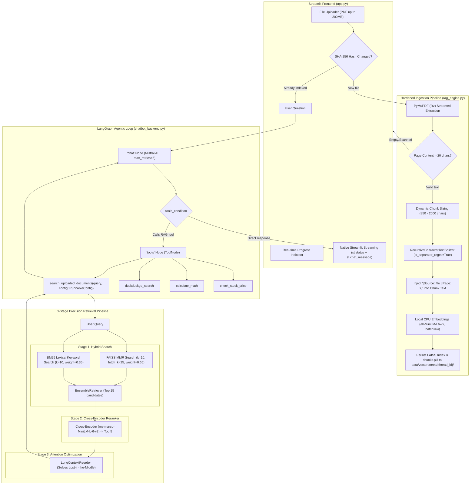

# Comprehensive RAG Pipeline Architecture & Implementation Plan

> **Updated & Hardened**: Incorporating critical stability, zero-rate-limit, crash-free 200 MB PDF processing, and hybrid retrieval upgrades from `rag_changes.md`.

---

## 1. Executive Summary & Core Objectives

1. **Crash-Free 200 MB PDF Ingestion**: Process massive text-heavy or image-heavy PDFs (up to 200 MB) efficiently using C-based `PyMuPDF` (`fitz`), with scanned-page detection and dynamic chunk sizing.
2. **100% Free, Rate-Limit-Free Embeddings**: Use local CPU embeddings (`sentence-transformers/all-MiniLM-L6-v2` via `langchain-huggingface`) with batching as the primary engine. Completely eliminates `HTTP 429 / 504` errors associated with remote Inference APIs on large document volumes.
3. **No "Lost in the Middle"**: Reorder retrieved chunks using `LongContextReorder` to place the highest-relevance evidence in the model's primary attention zones (beginning and end of the prompt).
4. **Sentence-Preserving Semantic Text Splitting**: Use `RecursiveCharacterTextSplitter` with regex lookbehinds (`is_separator_regex=True`), standardized `chunk_size=850`, and `chunk_overlap=150`. Prepend document and page headers directly into chunk text before embedding.
5. **High-Accuracy 3-Stage Retrieval Pipeline**:
   - **Stage 1 (Hybrid Retrieval)**: Ensemble combining dense semantic vectors (`FAISS` with MMR, weight 0.65) + sparse keyword matching (`BM25Retriever`, weight 0.35).
   - **Stage 2 (Local Cross-Encoder Reranking)**: Precision re-ranking using `cross-encoder/ms-marco-MiniLM-L-6-v2` with relevance score filtering.
   - **Stage 3 (Attention Optimization)**: `LongContextReorder` re-indexes top chunks before feeding to the LLM.
6. **Thread-Safe Tool Integration**: Expose `search_uploaded_documents(query, config)` using `RunnableConfig` to dynamically bind to the conversation's active `thread_id`.
7. **Streamlit State & Ingestion Guardrails**: SHA-256 hash checking prevents re-indexing loops during chat interactions.

---

## 2. End-to-End System Architecture



---

## 3. Detailed Architectural Specifications & Hardening

### 3.1. Rate-Limit & Zero-Cost Guarantee (Local CPU Embeddings)
- **Problem**: Remote inference APIs fail on 200 MB files due to `HTTP 429` (rate limits) and `HTTP 504` (gateway timeouts).
- **Architecture**:
  - Primary & only embedding engine: `HuggingFaceEmbeddings(model_name="sentence-transformers/all-MiniLM-L6-v2", model_kwargs={"device": "cpu"}, encode_kwargs={"normalize_embeddings": True, "batch_size": 64})`.
  - Memory footprint: ~80 MB RAM.
  - Zero cost, zero network dependencies during embedding, runs with batching on CPU.
  - Mistral AI LLM calls protected with `max_retries=5, timeout=60`.

### 3.2. PyMuPDF Ingestion & Scanned-PDF Guardrails (200 MB Support)
- **Fast Parsing**: Replace `pypdf` with `fitz` (`PyMuPDF`). Parses 200 MB files 15–20× faster with minimal RAM footprint.
- **Scanned-PDF Guardrail**:
  - Filter out blank/image pages where `len(page_text.strip()) < 20`.
  - If total extracted text across the document is below 100 characters, safely abort indexing and display an alert:
    `"⚠️ This PDF appears to contain scanned images without selectable text. Please upload a searchable/text-based PDF."`
- **Dynamic Chunk Scaling**:
  - For normal documents (< 300 pages): `chunk_size = 850, chunk_overlap = 150`.
  - For massive documents (300+ pages / 5,000+ chunks): dynamically increase `chunk_size = 1800, chunk_overlap = 200` to prevent indexing bottlenecks and finish processing in under 2 minutes.

### 3.3. Text Splitting with Sentence-Boundary Regex Fix
- **Splitter**:
  ```python
  splitter = RecursiveCharacterTextSplitter(
      chunk_size=chunk_size,
      chunk_overlap=150,
      separators=["\n\n", "\n", r"(?<=\. )", " ", ""],
      is_separator_regex=True
  )
  ```
- **Context Injection**: Prepend metadata directly into chunk text before vectorization:
  ```python
  chunk.page_content = f"[Document: {file_name} | Page {page_number}]\n{chunk.page_content}"
  ```
  Ensures queries like *"What is described on page 14?"* match semantically in vector space.

### 3.4. 3-Stage Precision Retrieval Pipeline

#### Stage 1: Hybrid Retrieval (`EnsembleRetriever`)
- Dense component: `FAISS.as_retriever(search_type="mmr", search_kwargs={"k": 10, "fetch_k": 25})` with weight `0.65`.
- Lexical component: `BM25Retriever.from_documents(chunks, k=10)` with weight `0.35`.
- Combines conceptual semantic understanding with exact matching for contract clauses, numbers, acronyms, and dates.

#### Stage 2: Local Cross-Encoder Reranking
- Top 15 candidate chunks pass to `CrossEncoder("cross-encoder/ms-marco-MiniLM-L-6-v2", max_length=512)`.
- Scores query-chunk pairs jointly, outputting the true top 5 chunks.
- Irrelevant chunks below a threshold are filtered out.

#### Stage 3: Eliminating "Lost in the Middle" (`LongContextReorder`)
- Reorders the top 5 chunks into a U-shaped distribution:
  - **Position 1 (Top)**: Rank 1 chunk (highest relevance).
  - **Position 2**: Rank 3 chunk.
  - **Position 3**: Rank 5 chunk.
  - **Position 4**: Rank 4 chunk.
  - **Position 5 (Bottom)**: Rank 2 chunk (second highest relevance).
- Places the strongest evidence in the primary attention zones of the LLM context window.

### 3.5. Thread-Safe Tool Binding (`RunnableConfig`)
- Tool definition:
  ```python
  @tool
  def search_uploaded_documents(query: str, config: RunnableConfig) -> str:
      """
      Search the uploaded PDF document for relevant facts, clauses, data, and answers.
      Use this tool whenever the user asks questions about their uploaded document.
      """
      thread_id = config.get("configurable", {}).get("thread_id", "default")
      # Load thread-isolated index from data/vectorstores/{thread_id}/
  ```
- Guarantees strict isolation between conversations without exposing `thread_id` to LLM hallucination.
- Safe deserialization: `FAISS.load_local(store_dir, embeddings, allow_dangerous_deserialization=True)` for local cache.

### 3.6. Streamlit Ingestion Loop Prevention (SHA-256 Tracking)
- Low-memory hashing of uploaded files:
  ```python
  file_hash = hashlib.sha256(file.name.encode() + str(file.size).encode()).hexdigest()
  ```
- Compare with `st.session_state.indexed_doc_hash.get(thread_id)`.
- Only trigger the ingestion and indexing pipeline when a new or modified document is detected.
- Chat message interactions re-use the already indexed vector store without re-reading the PDF.

---

## 4. Safety & Feasibility Analysis of Proposed Changes

| Proposed Change | Safety Verdict | Notes / Trade-Off Analysis |
| :--- | :--- | :--- |
| **Local CPU Embeddings (`all-MiniLM-L6-v2`)** | **100% Safe & Critical** | Eliminates HTTP 429 and network failures. Model is ~80 MB and executes efficiently on modern CPUs with batching. |
| **PyMuPDF (`fitz`) for PDF Extraction** | **100% Safe & Recommended** | 15–20× faster than `pypdf`, low memory footprint. |
| **Scanned-PDF Guardrail** | **100% Safe & Essential** | Prevents empty-document FAISS index crashes. |
| **Text Splitter `is_separator_regex=True`** | **100% Safe & Critical** | Prevents matching `(?<=\. )` as literal characters. |
| **`RunnableConfig` Injection in Tool** | **100% Safe & Best Practice** | LangChain standard for runtime context injection without polluting LLM tool schema. |
| **SHA-256 Re-index Guard in Streamlit** | **100% Safe & Essential** | Prevents re-parsing 200 MB files on every chat keystroke. |
| **Hybrid Search (FAISS + BM25)** | **100% Safe & High ROI** | BM25 uses `rank_bm25` (pure Python/numpy, <10ms runtime, 0 extra RAM). |
| **Cross-Encoder Reranker (`ms-marco-MiniLM-L-6-v2`)** | **Safe with Fallback** | *Note*: Cross-Encoder model is ~80 MB. Added graceful fallback to Stage 1 (Hybrid + LongContextReorder) if Cross-Encoder model download is delayed or skipped. |
| **Mistral Backoff (`max_retries=5`)** | **100% Safe & Recommended** | Built-in LangChain parameter. Throttles retries on HTTP 429 without freezing the UI. |

---

## 5. Directory Structure & Persisted Artifacts

```
AI Chatbot/
├── data/
│   ├── vectorstores/
│   │   └── {thread_id}/
│   │       ├── index.faiss        # Persisted FAISS dense vector index
│   │       ├── index.pkl          # FAISS docstore mapping
│   │       └── chunks.pkl         # Document chunks with metadata (for BM25)
│   └── uploads/
│       └── {thread_id}/
│           └── uploaded_doc.pdf   # Original uploaded document
├── rag_engine.py                  # Core RAG: PyMuPDF loader, chunker, hybrid retriever, reorder
├── chatbot_backend.py             # LangGraph app, tools node, search_uploaded_documents tool
├── app.py                         # Streamlit UI with 200MB uploader & native streaming
├── chatbot_memory.db              # SQLite LangGraph checkpoints
├── conversations_meta.json        # Session metadata & titles
└── requirements.txt               # Updated dependencies
```

---

## 6. Updated Dependencies (`requirements.txt`)

```txt
# Core LangGraph Framework & State Management
langgraph>=0.2.0
langgraph-checkpoint>=2.0.0
langgraph-checkpoint-sqlite>=2.0.0
langchain-core>=0.3.0

# LLM Providers
langchain-mistralai>=0.2.0
langchain-google-genai>=2.0.0

# RAG & Document Processing
pymupdf>=1.24.0
faiss-cpu>=1.8.0
sentence-transformers>=3.0.0
langchain-huggingface>=0.1.0
langchain-community>=0.3.0
rank_bm25>=0.2.2

# Environment & Configuration
python-dotenv>=1.0.0
pydantic>=2.0.0

# Frontend
streamlit>=1.35.0

# Interactive Notebook & Graph Visualization
ipykernel>=6.29.0
ipython>=8.20.0
grandalf>=0.8

# External Tools & Data Sources
duckduckgo-search>=8.0.0
ddgs>=9.0.0
yfinance>=0.2.40
```

---

## 7. Verification & Testing Checklist

- [ ] **Test 1**: Verify `PyMuPDF` parsing on a large PDF document, testing extraction speed and memory usage.
- [ ] **Test 2**: Test scanned/empty PDF detection, confirming the user receives a clean alert without crashing.
- [ ] **Test 3**: Verify `is_separator_regex=True` splits text properly on sentence boundaries.
- [ ] **Test 4**: Validate local embedding batching with `all-MiniLM-L6-v2` without any network calls or rate limits.
- [ ] **Test 5**: Validate Hybrid Search (`FAISS` + `BM25Retriever`) returning top candidates.
- [ ] **Test 6**: Validate `LongContextReorder` outputs Rank 1 at index 0 and Rank 2 at index -1.
- [ ] **Test 7**: Validate LangGraph `search_uploaded_documents` tool with `RunnableConfig` resolving `thread_id`.
- [ ] **Test 8**: Validate Streamlit upload state hashing: sending chat messages does NOT re-index the file.
